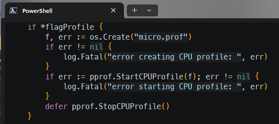

# vscode-default-dark theme for micro editor

This is a theme for the [micro editor](https://github.com/zyedidia/micro/),
based off of the Visual Studio Code "Dark 2026 (Default Dark)" theme.

## Installation

To install, Ctrl-E and type `plugin install vscode-default-dark`

Or download the file `vscode-default-dark.micro` and place in `~/.config/micro/colorschemes`.
